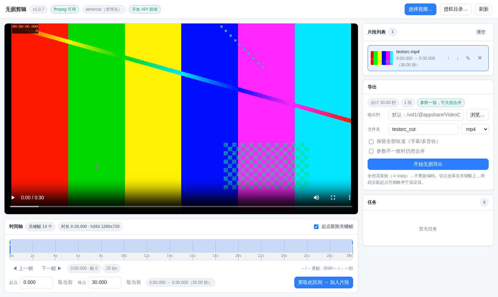
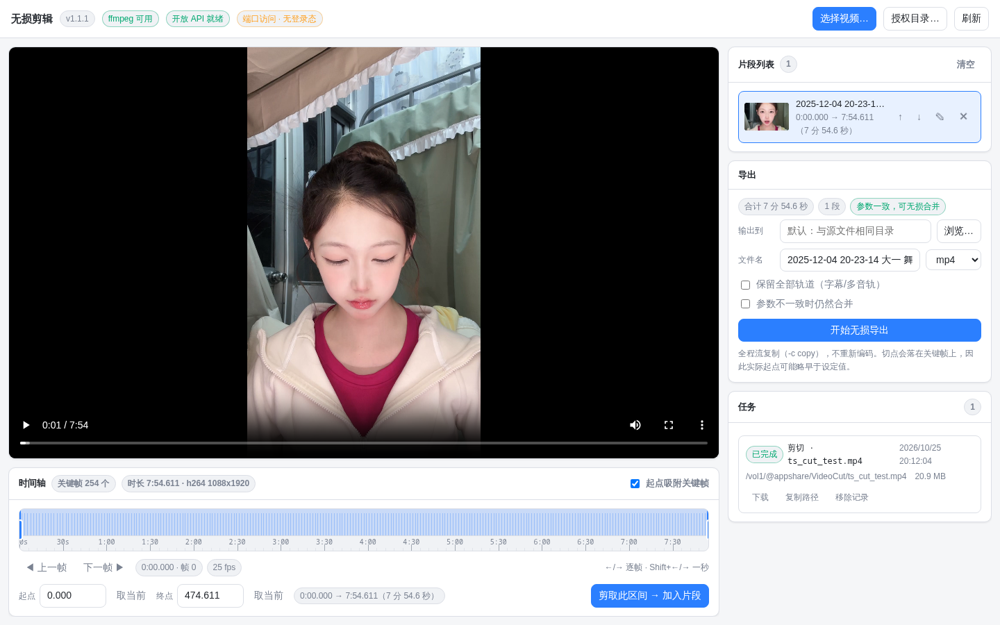
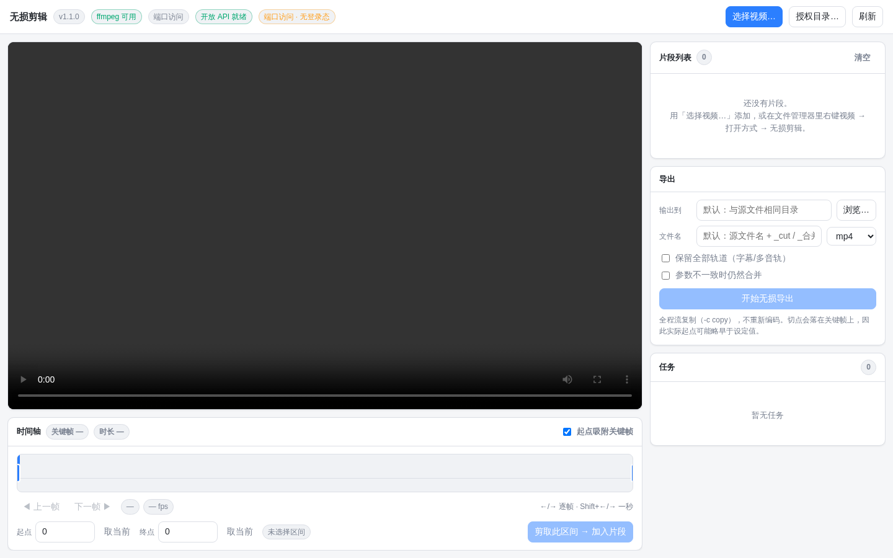

# 无损剪辑 (videocut)

飞牛 fnOS 第三方应用：**视频无损切割与合并**。

在飞牛文件管理器里选中视频 → 右键 → **打开方式 → 无损剪辑**，就能直接打开这个工具：拖时间轴、按关键帧标记区间、无损剪切；也可以把多个视频首尾相接合并成一个文件。全程流复制（`-c copy`），**不重新编码、不损失画质、速度接近磁盘拷贝**。

当前版本：**1.1.1**　　运行要求：**fnOS ≥ 1.1.3100**

> 项目地址：<https://github.com/aimercat1994/fnos-videocut>　·　问题反馈与建议请提 [Issue](../../issues)




---

## 功能

| 功能 | 说明 |
| --- | --- |
| 无损切割 | 按 `-ss` 前置 + `-c copy` 剪切，不重编码；起点可按关键帧自动吸附，避免黑屏首帧 |
| 无损合并 | 多个片段各自无损剪切后用 concat 解复用器 `-c copy` 串接，同样零重编码 |
| 关键帧时间轴 | 时间轴带时间刻度标尺，叠加源文件关键帧刻度，可拖拽起止手柄或直接输入时间 |
| 逐帧定位 | 「上一帧 / 下一帧」按钮，以及 `←` `→` 方向键逐帧、`Shift+←/→` 跳一秒；实时显示当前帧号与源帧率 |
| 片段列表 | 多段任意排序（上移 / 下移 / 编辑 / 移除），单段即剪切、多段即合并，导出前自动预检各段参数是否一致 |
| 系统文件选择器 | 直接调用 fnOS 原生选择器，可多选、系统自动授予读取权限；也支持系统目录选择器指定输出目录 |
| 任务进度 | 基于 `ffmpeg -progress` 的实时进度（剪切 65% + 合并 35% 加权）、任务历史、取消、结果下载 |
| 文件管理器集成 | 注册 30 种视频扩展名到「打开方式」菜单，同时提供桌面图标入口 |
| 端口访问 | 除网关入口外，还在 `18299` 端口（可改可关）提供同一套界面，浏览器直接打开即可，不必登录飞牛桌面 |

## 安装

### 方式一：应用中心手动安装（推荐）

从 [Releases](../../releases) 下载最新的 `videocut.fpk`，在飞牛 fnOS 的**应用中心 → 手动安装**中选择该文件。

### 方式二：命令行

```bash
appcenter-cli install-fpk videocut.fpk
```

> 注意：`appcenter-cli install-fpk` 对**已安装**的应用不会覆盖文件。升级请先在应用中心卸载，或使用应用中心界面的升级。

### 方式三：从源码构建

需要 fnOS 自带的 `fnpack`（`/usr/local/bin/fnpack`）：

```bash
git clone https://github.com/aimercat1994/fnos-videocut.git
cd videocut
fnpack build -d .
# 产出 videocut.fpk，然后按方式一或方式二安装
```

## 使用

1. **打开**：在文件管理器里右键视频 → 打开方式 → 无损剪辑；或从飞牛桌面点击「无损剪辑」图标，再点「选择视频…」。
2. **取区间**：拖动时间轴上的两个手柄选定区间，或用「取当前」按钮把播放头位置设为起点 / 终点；开启「起点吸附关键帧」可让起点对齐到最近的关键帧。
   - 精确到帧：用「◀ 上一帧 / 下一帧 ▶」或 `←` `→` 方向键定位，`Shift+←/→` 一次跳一秒。
3. **加入片段**：点「剪取此区间 → 加入片段」。重复此步可加入多段；只加一段就是剪切，加多段就是合并。
4. **导出**：在「导出」卡片里确认输出目录（默认与源文件同目录，可用系统目录选择器改到共享目录）、文件名与容器格式，点「开始导出」。
5. **查看**：任务卡片里显示进度；完成后可直接下载结果或复制文件路径。

## 支持的格式

`mp4` `mkv` `mov` `m4v` `webm` `ts` `m2ts` `mts` `trp` `tp` `avi` `flv` `wmv` `mpg` `mpeg` `3gp` `vob` `rmvb` `rm` `asf` `ogv` `divx` `f4v` `m2v` `mxf` `dv` `m3u8` `mp2` `mpe` `mpv`

浏览器能直接播放的容器（`mp4` / `mkv` / `webm` / `mov` 等）直接预览。**直播录像常见的 `.ts` / `.m2ts` 等 MPEG-TS 文件浏览器放不了**，所以打开这类文件时，应用会先用 `-c copy` 无损转封装出一份可播放的 MP4 预览副本（166 MB 的录像约 1 秒，缓存在应用数据目录，14 天未用自动清理），再交给播放器。

剪切和合并始终只针对**原文件**，预览副本只用来显示画面、定位时间点——所以看到的时长、时间码与最终切出来的结果一致，画质也不受影响。



## 端口访问（可选）

除了飞牛桌面里的入口，应用还会在 **18299** 端口上提供同一套界面，用普通浏览器直接打开即可：

```text
http://<飞牛设备 IP>:18299/
```

- **没有登录态**：端口上的请求不经过飞牛统一网关，不会被注入用户身份，而是按应用用户 `videocut` 的**真实文件权限**工作。界面上会显示「端口访问 · 无登录态」徽标。适合内网自用，**不要把这个端口暴露到公网**。
- **差异**：系统文件选择器属于飞牛桌面的一部分，端口访问下不可用，请用「授权目录…」浏览应用有权读取的目录；输出目录同理。
- **改端口 / 关闭**：应用启动前读取环境变量 `VC_PORT`（`0` / `off` 表示关闭端口访问，只保留网关入口）与 `VC_BIND`（默认 `0.0.0.0`，可设为 `127.0.0.1` 只允许本机）。安装版可在这两个位置加一行 `export VC_PORT=...` 后重启应用：`/var/apps/videocut/cmd/main`（或源码里的 `cmd/main`）。
- 网关入口（飞牛桌面 / 文件管理器「打开方式」）的行为**完全不变**：仍由飞牛校验登录并注入用户身份，权限按登录用户判定。



## 工作原理

- **不重编码**：切割用 `ffmpeg -ss <start> -i <src> -t <dur> -c copy`，合并用 `-f concat -safe 0 -i list -c copy`。因此切点会吸附到关键帧，剪切点不是任意帧——这是无损方案的固有代价，也是它快和不掉画质的原因。
- **服务端**：纯 Python 标准库（无需第三方依赖），同时监听两种入口：应用 `target` 目录下的 Unix Socket（由 fnOS **统一网关** `/app/videocut` 校验登录态后转发，并注入可信头 `X-Trim-Userid` / `X-Trim-Isadmin` / `X-Trim-Username`），以及 `18299` 端口（可选的免登录入口，见上一节）。
- **前端**：原生 HTML/CSS/JS，无构建步骤、无框架，直接由后端作为静态资源提供，并注入网关前缀。
- **权限**：应用以专用低权用户 `videocut` 运行（`run-as: package`）。除文件系统自身的可读性外，还会通过 fnOS 开放 API（`trim.file.checkUserACL` / `trim.file.userAccess` / `trim.file.path`）按**当前登录用户**复核路径权限；路径统一 realpath 规范化并拒绝 `..` 穿越。

## 目录结构

```
manifest                 应用清单（版本、依赖、平台、桌面入口…）
config/privilege         运行身份（run-as: package，专用用户 videocut）
config/resource          数据共享目录 + 开放 API scope
app/ui/config            桌面入口 / 文件管理器「打开方式」注册（fileTypes）
app/ui/images/           入口图标 icon_64.png / icon_256.png
ICON.PNG ICON_256.PNG    应用图标
cmd/main                 start / stop / status 生命周期脚本（PID 文件 + 套接字就绪等待）
cmd/*_init *_callback    install / upgrade / uninstall / config 钩子
app/server/main.py       服务进程入口（创建 socket、写 pid、信号清理）
app/server/vc/core.py    配置与环境变量、日志、路径校验
app/server/vc/media.py   ffprobe/ffmpeg 封装：探测、关键帧、缩略图、剪切/合并命令
app/server/vc/jobs.py    任务队列与进度（持久化到 jobs.json）
app/server/vc/grants.py  文件/目录授权登记（系统选择器回传 → 可访问）
app/server/vc/trimapi.py fnOS 开放 API 客户端（Unix Socket + TRIM_API_TOKEN）
app/server/vc/httpd.py   Unix Socket + 可选 TCP 端口上的 HTTP 服务与路由
app/www/                 前端（index.html / style.css / app.js / callback.html）
tools/make_icons.py      纯标准库图标生成器（4× 超采样抗锯齿）
docs/                    截图
```

## 开发

```bash
# 静态前端改动可以直接热更新到已安装的应用（httpd 对静态资源返回 Cache-Control: no-store，刷新即生效）
cp -f app/www/*.{html,css,js} /vol1/@appcenter/videocut/www/

# 后端改动需要重新打包安装
fnpack build -d .
appcenter-cli uninstall videocut && appcenter-cli install-fpk videocut.fpk

# 重新生成图标
python3 tools/make_icons.py

# 查看运行日志
tail -f /vol1/@appdata/videocut/server.log
```

## 已知限制

- 无损切割的切点会对齐到关键帧；需要精确到任意帧就必须重编码，本工具不做。
- 合并要求各片段的编码参数一致（分辨率、编码器、像素格式、声道/采样率）。导出前的预检会给出警告，但可以强制继续——参数不一致时部分播放器可能无法正常播放。
- 目前仅支持视频文件（30 种扩展名）。
- 浏览器无法直接播放的容器（`.ts` / `.m2ts` / `.avi` / `.flv` / `.rmvb` 等）需要先生成预览副本，会在应用数据目录里占用与源文件相当的磁盘空间（14 天未使用自动清理）。
- 未上架飞牛官方应用中心，通过手动安装 `.fpk` 使用。

## 第三方组件

- `app/www/vendor/trim-app.js`：飞牛 fnOS 官方前端 SDK `@trimjs/web-app` 的浏览器构建产物，为离线可用而随包分发，版权归其原作者所有。

## 许可

MIT License（见 [LICENSE](LICENSE)）。

---

本项目为个人开发的第三方应用，与飞牛 fnOS 官方无关。
